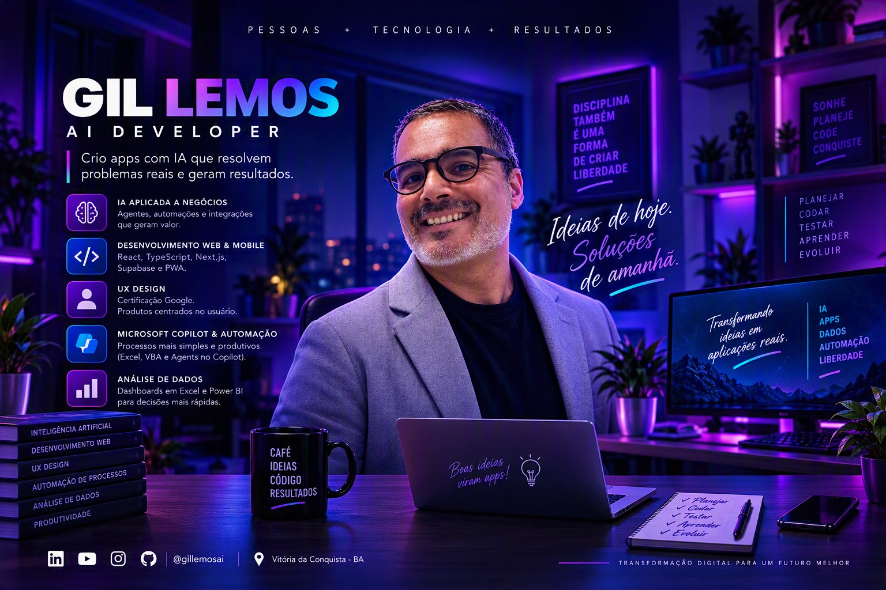

  

<h1 align="center">Oi, eu sou o Gil Lemos 👋</h1>

  <b>Desenvolvo apps, sistemas web e automações com escopo definido, unindo design, UX e desenvolvimento assistido por IA.</b> 
  Apps e Sistemas Web · UX/UI e Design Gráfico · Automação e Dados · Vitória da Conquista (BA)

  
  
  
  
  

© 2026 <b>Gil Lemos</b> · <a href="https://gillemosai.com">gillemosai.com</a>

---

## 🧭 Como posso ajudar

- 💻 **Apps web e PWAs:** agendamentos, cadastros, controles e ferramentas internas, com escopo definido para cada projeto
- 🌐 **Landing pages e sites:** apresentação de serviços, experiência mobile e caminhos claros para contato
- ⚙️ **Automação e dados:** planilhas, macros em Excel/VBA e dashboards para reduzir tarefas repetitivas
- 🎨 **UX/UI e design gráfico:** interfaces, protótipos, identidade visual e materiais digitais (+10 anos em design)

Stack que uso nos projetos: **React, TypeScript, Vite, Supabase, PWA**, Excel/VBA e ferramentas de desenvolvimento com IA. Sigo estudando programação (Python e análise de dados).

## 📱 Apps do portfólio

| Projeto | O que faz | Código / demonstração |
|---|---|---|
| 💰 **Finanza** | Organização financeira pessoal (PWA) · produto próprio | [Testar ao vivo](https://gillemosai.com/apps/finanza/) · código privado |
| 🧠 **[5Task](https://github.com/gillemosai/5taskProcrastinacaoZero)** | Produtividade anti-procrastinação, limite de 5 tarefas ativas (PWA) · produto próprio | [Testar agora](https://5task-procrastinacao-zero.vercel.app/) |
| 💈 **BarberTalk** | Agendamento e gestão para barbearias | Código privado · demonstração sob solicitação |
| 🦷 **OdontoCau** | Gestão de clínicas odontológicas | Código privado · demonstração sob solicitação |

## 🧪 Projetos abertos

| Projeto | O que faz | Links |
|---|---|---|
| ⌨️ **[dell-g15-keyboard-backlight-solution](https://github.com/gillemosai/dell-g15-keyboard-backlight-solution)** | Acende e muda a cor do teclado do Dell G15 no **Windows e no Linux**, sem depender do Alienware Command Center | [Baixar o .exe](https://github.com/gillemosai/dell-g15-keyboard-backlight-solution/releases/latest) |
| 🖱️ **[gillemosai-cursor-themes](https://github.com/gillemosai/gillemosai-cursor-themes)** | Temas de cursor grandes para Linux (a partir de 72 px), feitos para tutoriais e lives | [Ver no GitHub](https://github.com/gillemosai/gillemosai-cursor-themes) |
| 📊 **[Análise de dados e planilhas](https://github.com/gillemosai/analise_de_dados)** | Dashboards em Excel com macros VBA, tabelas dinâmicas e controle financeiro (projetos de estudo DIO/Santander) | [Ver projetos](https://github.com/gillemosai/analise_de_dados) |

  

## 🎓 Formação

Marketing · Pós-graduação em IA para Negócios · Certificado Google UX Design

## 📩 Vamos conversar

Disponível para projetos freelance, parcerias com agências e trabalho remoto no período noturno. Me conte o problema que você quer resolver e eu respondo com uma proposta de escopo, prazo e investimento: [gillemosai.com](https://gillemosai.com) · [LinkedIn](https://www.linkedin.com/in/gillemosai/).

## 🌍 English

I'm **Gil Lemos**, from Brazil. I build web apps, PWAs and automations with a defined scope, combining 10+ years of graphic design, UX (Google certified) and AI-assisted development. Portfolio apps include Finanza (personal finance), 5Task (productivity), BarberTalk (barbershop scheduling) and OdontoCau (dental clinic management). Open source: a Dell G15 keyboard-backlight fix and large Linux cursor themes. Reach out via [gillemosai.com](https://gillemosai.com).
