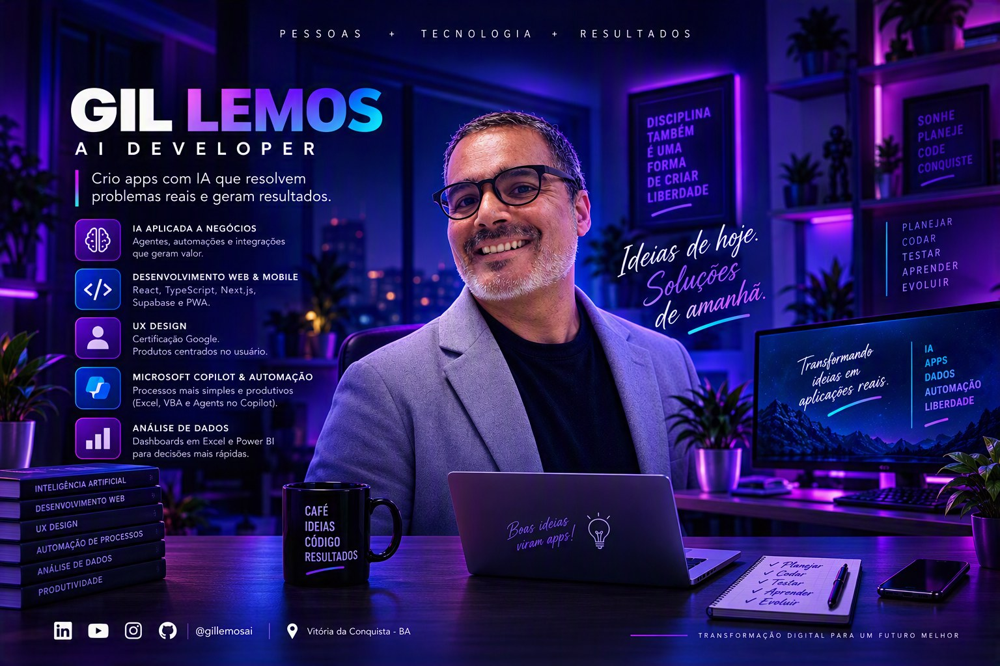

  

<h1 align="center">Oi, eu sou o Gil Lemos 👋</h1>

  <b>Crio apps com IA que resolvem problemas reais e geram resultados.</b> 
  AI Developer · UX Design (certificado Google) · Automação com Copilot · Análise de dados

  
  
  
  

© 2026 <b>Gil Lemos</b> · <a href="https://gillemosai.com">gillemosai.com</a>

---

## 🚀 Projetos em destaque

| Projeto | O que faz | Links |
|---|---|---|
| ⌨️ **[dell-g15-keyboard-backlight-solution](https://github.com/gillemosai/dell-g15-keyboard-backlight-solution)** | Acende e muda a cor do teclado do Dell G15 no **Windows e no Linux**, sem depender do Alienware Command Center | [Baixar o .exe](https://github.com/gillemosai/dell-g15-keyboard-backlight-solution/releases/latest) |
| 🧠 **[5task](https://github.com/gillemosai/5taskProcrastinacaoZero)** | App de produtividade anti-procrastinação, com gamificação, funciona offline (PWA) | [Testar agora](https://5task-procrastinacao-zero.vercel.app/) |
| 📊 **[Análise de dados e planilhas](https://github.com/gillemosai/analise_de_dados)** | Dashboards em Excel com macros VBA, tabelas dinâmicas e controle financeiro | [Ver projetos](https://github.com/gillemosai/analise_de_dados) |
| 🌐 **[Portfólio com IA](https://github.com/gillemosai/gillemosai-Portfolio-Manus_AI)** | Meu portfólio profissional em React + Vite + Tailwind | [gillemosai.com](https://gillemosai.com) |

  

## 🛠️ No que eu trabalho

- 🤖 **IA aplicada a negócios:** agentes, automações e integrações que geram valor
- 💻 **Web e mobile:** React, TypeScript, Next.js, Supabase e PWA
- 🎨 **UX Design:** produtos centrados no usuário
- ⚙️ **Microsoft Copilot e automação:** Excel, VBA e agentes para processos mais simples
- 📈 **Análise de dados:** dashboards em Excel e Power BI para decisões mais rápidas

## 🌍 English

I'm **Gil Lemos**, an AI developer from Brazil. I build apps with AI that solve real problems: a keyboard-backlight fix for Dell G15 laptops (Windows + Linux), an offline-first productivity PWA, and Excel/VBA dashboards. Feel free to open an issue or reach out via [gillemosai.com](https://gillemosai.com).

---

Transformação digital para um futuro melhor

